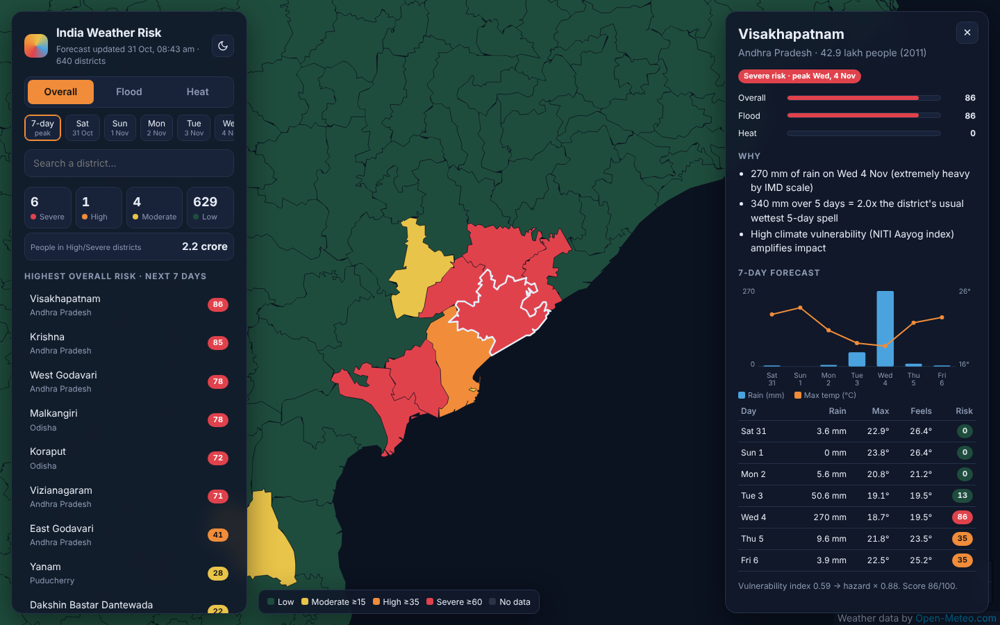
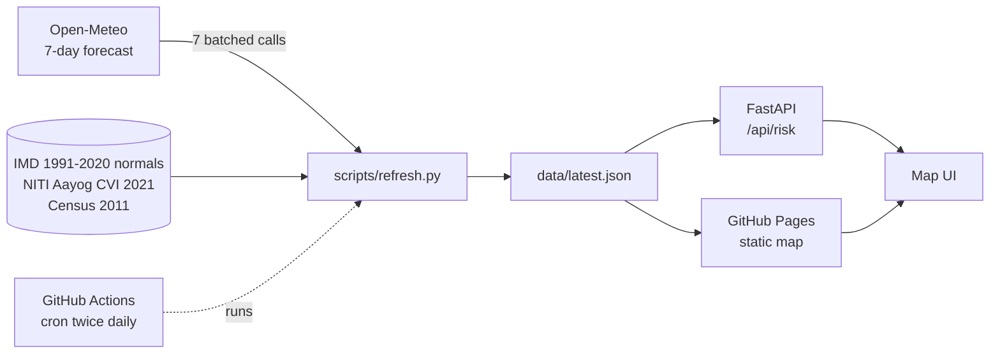

# India Weather Risk

**Which Indian districts should worry about floods or heatwaves this week?**
A live map that scores 7-day flood and heat risk for all 640 districts. It updates twice a day, needs no API keys and runs free on GitHub Pages.

[](https://github.com/deepankarkumar1310/india-weather-risk/actions/workflows/ci.yml)
[](https://github.com/deepankarkumar1310/india-weather-risk/actions/workflows/refresh.yml)


**[Live map →](https://deepankarkumar1310.github.io/india-weather-risk/)**



## Features

- **District-level risk map:** 640 districts coloured Low / Moderate / High / Severe. Switch between flood, heat and overall risk.
- **Day by day:** see the peak over the next 7 days, or pick a single day.
- **Explains every score:** click a district for a forecast chart and plain-language reasons, for example *"132 mm of rain on Tue 4 Nov (very heavy by IMD scale)"*.
- **Accounts for local climate:** 100 mm of rain is routine in Mumbai but extreme in Jaisalmer. Scores compare the forecast with each district's own 30-year normal.
- **Accounts for vulnerability:** the same storm hurts more where people are less able to cope. Scores are weighted by the NITI Aayog Climate Vulnerability Index.
- **Public REST API** with interactive docs at `/docs`.
- **Fully automated:** GitHub Actions fetches new forecasts, rescores every district, commits the snapshot and redeploys the site.

## How it works



**Risk = hazard × vulnerability** (the IPCC definition).

| Part | How it's scored |
|---|---|
| Flood hazard | 60% from rain intensity on IMD's scale (heavy 64.5 mm, very heavy 115.6 mm, extremely heavy 204.5 mm a day), 40% from the 5-day total compared with the district's normal wettest 5-day spell |
| Heat hazard | Max temperature against IMD heatwave limits (40 °C, severe 45 °C) or feels-like temperature, whichever is worse. Warm nights (≥30 °C) add risk; a one-day spike counts for less than a heatwave of two or more days |
| Vulnerability | NITI Aayog CVI scaled to a ×0.5–×1.0 weight. Missing districts get their state's median |
| Levels | Low < 15 ≤ Moderate < 35 ≤ High < 60 ≤ Severe |

The full method, with the reasoning behind each number, is in [docs/METHODOLOGY.md](docs/METHODOLOGY.md).

## API

| Endpoint | Returns |
|---|---|
| `GET /api/risk?hazard=flood&min_level=High&state=Odisha` | Districts ranked by risk |
| `GET /api/risk/{code}` | 7-day breakdown and drivers for one district |
| `GET /api/districts` | All districts with their coordinates and climate normals |
| `GET /api/health` | When the data was last refreshed |

```bash
curl "http://localhost:8000/api/risk?hazard=heat&limit=5"
```

## Run it locally

```bash
git clone https://github.com/deepankarkumar1310/india-weather-risk && cd india-weather-risk
```

```bash
python -m venv .venv && source .venv/bin/activate && pip install -r requirements-dev.txt
```

```bash
python scripts/refresh.py
```

```bash
uvicorn app.main:app --reload
```

Open http://localhost:8000 for the map, or http://localhost:8000/docs for the API.

Or with Docker:

```bash
docker build -t india-weather-risk . && docker run -p 8000:8000 india-weather-risk
```

Run the tests with `pytest`. They use a recorded API response, so they work offline.

## Deploy

- **GitHub Pages (static map, free):** go to *Settings → Pages* and set *Source* to **GitHub Actions**. Then run the *Refresh forecast* workflow once from the *Actions* tab. After that, the site redeploys on its own after every refresh.
- **Render (map + API, free):** go to *New → Blueprint* and pick this repo. `render.yaml` sets everything up.

## Project layout

```
app/        risk.py (scoring) · forecast.py (Open-Meteo client) · pipeline.py · main.py (FastAPI)
web/        map UI: plain HTML/CSS/JS + Leaflet, no build step
data/       districts.csv · districts.geojson · latest.json (refreshed by CI)
scripts/    refresh.py (daily job) · build_districts.py (one-off data prep)
tests/      unit, pipeline and API tests
```

## Limitations

- **This is not an official warning.** For real alerts, follow [IMD](https://mausam.imd.gov.in/) and your state disaster management authority.
- Each district uses the forecast for one point inside it. Large or mountainous districts can vary a lot within their borders.
- Boundaries are from the 2011 census (640 districts). Districts created after 2011 are shown as part of their parent district.
- The heat thresholds are IMD's limits for the plains. Hill districts (where IMD uses 30 °C) are likely under-scored.
- Flood risk is based on rainfall only. It does not model rivers, dams, drainage or storm surge.

## Data and credits

| Data | Source | Licence |
|---|---|---|
| Weather forecast | [Open-Meteo](https://open-meteo.com/) | CC BY 4.0 |
| 1991–2020 rainfall and temperature normals | India Meteorological Department gridded data | Government of India |
| Climate Vulnerability Index 2021 | NITI Aayog via [NDAP](https://ndap.niti.gov.in/) | GODL-India |
| Population | Census of India 2011 | GODL-India |
| District boundaries | [DataMeet](https://github.com/datameet/maps) | CC BY 2.5 IN |

Code is released under the [MIT](LICENSE) licence.
